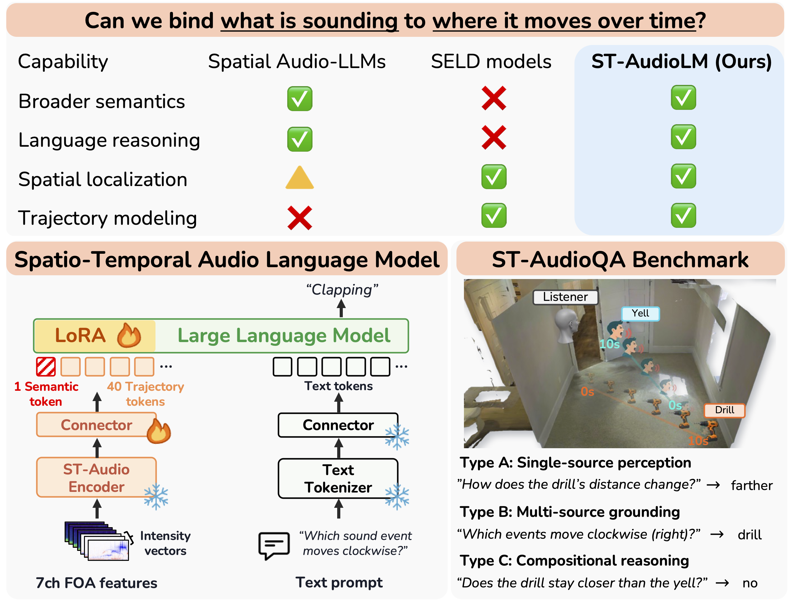

<h1 align="center">Spatio-Temporal Audio Language Modeling<br>for Dynamic Sound Sources</h1>

<p align="center"><strong>EMNLP 2026 Main</strong></p>

<p align="center">
  Oh Hyun-Bin<sup>1,*</sup>, Kazuki Shimada<sup>2</sup>, Yuhta Takida<sup>2</sup>,
  Kim Sung-Bin<sup>1</sup>, Toshimitsu Uesaka<sup>2</sup>, Takashi Shibuya<sup>2</sup>,<br>
  Kyeongyoon Lee<sup>4</sup>, Tae-Hyun Oh<sup>5,†</sup>, Yuki Mitsufuji<sup>2,3,†</sup>
</p>

<p align="center">
  <sup>1</sup>POSTECH &nbsp; <sup>2</sup>Sony AI &nbsp; <sup>3</sup>Sony Group Corporation<br>
  <sup>4</sup>Sungkyunkwan University &nbsp; <sup>5</sup>KAIST<br>
  <em><sup>*</sup>Work done during an internship at Sony AI. &nbsp; <sup>†</sup>Co-corresponding authors.</em>
</p>

<p align="center">
  <a href="https://st-audiolm.github.io/">
    
  </a>
  <a href="https://arxiv.org/abs/2606.14141">
    
  </a>
  <a href="https://huggingface.co/HBoh/ST-AudioLM">
    
  </a>
  <a href="https://huggingface.co/datasets/HBoh/ST-AudioQA">
    
  </a>
</p>

<p align="center">
  
</p>

<p align="center">
  <strong>ST-Audio Encoder</strong> represents what is sounding and how it moves with one semantic token
  and 40 time-resolved tokens.<br>
  <strong>ST-AudioLM</strong> connects these tokens to a language model for semantic, spatial, and temporal
  reasoning over dynamic sound sources.
</p>

## Overview

This repository contains two independently usable inference paths:

- **ST-Audio Encoder** takes a 10-second first-order ambisonic recording and returns 40 temporal embeddings, one semantic embedding, and time-resolved direction, distance, and activity predictions. It can be used without loading an LLM.
- **ST-AudioLM** loads the bundled Encoder, projects its 41 audio tokens into [OLMo-2-1124-7B-Instruct](https://huggingface.co/allenai/OLMo-2-1124-7B-Instruct), and answers natural-language questions about sound identity, position, and motion.

Both components are released in one [Hugging Face model repository](https://huggingface.co/HBoh/ST-AudioLM). The Encoder remains independently loadable without the LLM.

[ST-AudioQA](https://huggingface.co/datasets/HBoh/ST-AudioQA) is the accompanying benchmark. It provides QA annotations, AudioSet segment references, acoustic-scene recipes, and the exact RIRs used for the test split. Original AudioSet waveforms and Matterport3D scene assets are not redistributed.

## Getting Started

### 1. Install

Use Python 3.10+ and install a PyTorch build suitable for your hardware. Then run:

```bash
git clone https://github.com/SonyResearch/ST-AudioLM.git
cd ST-AudioLM
python -m pip install -e .
```

The model and dataset repositories are gated. Accept their access terms on
Hugging Face, then authenticate once with `hf auth login` before downloading
weights or data.

Verify the standalone Encoder without preparing an audio file:

```bash
python scripts/smoke_test.py --encoder-model HBoh/ST-AudioLM --device cpu
```

The full model has been tested with bfloat16 inference on an NVIDIA H100. The Encoder can also run on CPU, although it is slower.

### 2. Prepare FOA Audio

Pass your own 10-second, 32-kHz, four-channel **AmbiX ACN/SN3D** WAV, FLAC, or NPY recording in standard `[W, Y, Z, X]` channel order.

The loader validates the format but deliberately does not resample, crop, or peak-normalize audio. NPY arrays may have shape `[4, 320000]` or `[320000, 4]`.

### 3. Run ST-Audio Encoder by Itself

Command line:

```bash
python scripts/encode.py example.wav --output example_features.npz
```

Python:

```python
from staudiolm import STAudioEncoder, load_foa

audio = load_foa("example.wav")
encoder = STAudioEncoder.from_pretrained(
    "HBoh/ST-AudioLM",
    device="cuda",
)

outputs = encoder(audio)
tokens = outputs["audio_tokens"]  # [1, 41, 768]: 40 temporal + 1 semantic

direction = outputs["direction"]          # [1, 40, 3]
distance = outputs["distance_log"].exp()  # [1, 40]
activity = outputs["activity_logits"].sigmoid()
```

The CLI saves these outputs and the encoder tokens in a NumPy `.npz` file, making the Encoder usable as a standalone feature extractor or trajectory estimator.

### 4. Run ST-AudioLM

Command line:

```bash
python scripts/infer.py example.wav \
  "Where is the siren at the end of the clip?"
```

Python:

```python
from staudiolm import STAudioLM, load_foa

audio = load_foa("example.wav")
model = STAudioLM.from_pretrained("HBoh/ST-AudioLM", device="cuda")
answer = model.generate(audio, "Where is the siren at the end of the clip?")[0]
print(answer)
```

The model repository contains both ST-Audio Encoder and ST-AudioLM. OLMo-2 is downloaded separately and is not duplicated in the release. Local directories are supported for offline use:

```bash
python scripts/infer.py example.wav "How does the source move?" \
  --model ./weights/ST-AudioLM \
  --base-model ./weights/olmo2 \
  --local-files-only
```

## ST-AudioQA

Install the data dependencies first:

```bash
python -m pip install -e ".[data]"
```

Load each public table independently:

```python
from datasets import load_dataset

qa = load_dataset("HBoh/ST-AudioQA", "qa")
recordings = load_dataset("HBoh/ST-AudioQA", "recordings")
sources = load_dataset("HBoh/ST-AudioQA", "sources")
rir_recipes = load_dataset("HBoh/ST-AudioQA", "rir_recipes")
rir_test_index = load_dataset("HBoh/ST-AudioQA", "rir_test_index")
```

The release contains:

- paper-aligned train, validation, and test QA splits;
- stable recording and source IDs with AudioSet YouTube IDs and time segments;
- the complete Matterport3D/Habitat-Sim geometry and trajectory recipes;
- exact, deduplicated test RIRs for benchmark reproduction; and
- checksums and provenance metadata.

Users acquire the referenced source audio and Matterport3D assets from their original providers. Train and validation RIRs can then be rendered from the recipes; test evaluation uses the released exact RIRs because Habitat-Sim re-rendering is not guaranteed to be bit-exact across versions. Reconstructed model input is 10-second, 32-kHz AmbiX ACN/SN3D audio in `[W, Y, Z, X]` order. See [ST-AudioQA data and reconstruction](docs/data.md).

Download only the shard containing one exact test RIR and extract it with:

```bash
python scripts/extract_test_rir.py RIR_ID --output rirs/RIR_ID.npz
```

## Documentation

- [Model files and offline use](docs/checkpoints.md)
- [ST-AudioQA data and reconstruction](docs/data.md)
- [Smoke and regression testing](docs/testing.md)

## Acknowledgements

ST-AudioLM builds on [BAT](https://arxiv.org/abs/2402.01591) and its [Spatial-AST encoder](https://github.com/zszheng147/Spatial-AST), as well as [OLMo-2](https://huggingface.co/allenai/OLMo-2-1124-7B-Instruct), [Transformers](https://github.com/huggingface/transformers), and [PEFT](https://github.com/huggingface/peft).

## License

Original source code and documentation are released under the [MIT License](LICENSE). Portions adapted from third-party projects remain subject to their original terms; copies are collected in [`third_party_licenses/`](third_party_licenses). Model weights and ST-AudioQA assets have separate terms described in their Hugging Face cards.

## Citation

```bibtex
@article{hyun2026spatio,
  title={Spatio-Temporal Audio Language Modeling for Dynamic Sound Sources},
  author={Hyun-Bin, Oh and Shimada, Kazuki and Takida, Yuhta and Sung-Bin, Kim and Uesaka, Toshimitsu and Shibuya, Takashi and Lee, Kyeongyoon and Oh, Tae-Hyun and Mitsufuji, Yuki},
  journal={arXiv preprint arXiv:2606.14141},
  year={2026}
}
```

## Contact

hyunbinoh@postech.ac.kr or hyunbin70@gmail.com
